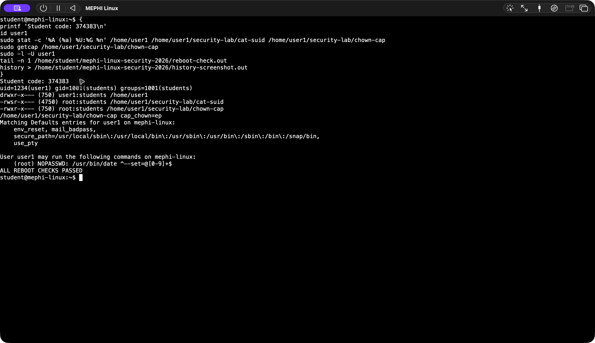

# Защита сетей: безопасность GNU/Linux

Учебная работа МИФИ, 2026. **Шифр студента: 374383.**

Работа выполнена в отдельной виртуальной машине **Ubuntu 24.04.5 LTS ARM64** в UTM на Mac. Настройка Linux, сбор результатов и публикация выполнены из командной строки. Пользователь `student` — администратор учебной машины, `user1` — обычный пользователь задания.

## Результаты

| Раздел | Что сделано | Подтверждение |
|---|---|---|
| 1. Пользователь | Создан `user1`, UID `1234`, основная группа `students`; домашний каталог `/home/user1`, режим `0750`. Максимальный срок пароля — `90` дней, предупреждение — за `7` дней. | [user-account.out](user-account.out), [etc/passwd](etc/passwd), [etc/group](etc/group), [etc/shadow](etc/shadow), [stat.out](stat.out) |
| 2. Файлы | Выполнен поиск `find / -type f -perm -4000 -print`; найдено 14 файлов, включая учебную копию `cat`. | [suid-files.out](suid-files.out), [suid-find-errors.out](suid-find-errors.out) |
| 2. Процессы | Во втором терминале от `user1` запущен `passwd`. Зафиксирован процесс с RUID `1234`, EUID `0`. | [privileged-processes.out](privileged-processes.out), [history-monitor.out](history-monitor.out) |
| 3. set-UID | Копия `/usr/bin/cat` помещена в `/home/user1/security-lab/cat-suid`, владелец `root:students`, режим `4750`. Обычный `cat` не читает файл root с режимом `0600`; копия с set-UID читает его успешно. | [setuid-demo.out](setuid-demo.out), [stat.out](stat.out) |
| 4. Capabilities | Копии `/usr/bin/chown` в `/home/user1/security-lab/chown-cap` назначена только capability `cap_chown=ep`. Обычный `chown` от `user1` получает отказ; копия меняет владельца учебного файла на `root:root`. | [capabilities-demo.out](capabilities-demo.out), [getcap.out](getcap.out), [stat.out](stat.out) |
| 5. sudo | `user1` разрешён запуск `/usr/bin/date` от root только с единственным аргументом `--set=@<число секунд Unix>`. Системное время успешно изменено на 60 секунд вперёд, затем возвращено; синхронизация NTP включена обратно. | [sudo-time-demo.out](sudo-time-demo.out), [sudo-permissions.out](sudo-permissions.out), [etc/sudoers.d/90-mephi-user1-time](etc/sudoers.d/90-mephi-user1-time) |
| 6. Артефакты | Сохранены история команд, выводы проверок, копии конфигурации и настоящий скриншот терминала со шифром студента. | [history.out](history.out), [mephi-screenshot.png](mephi-screenshot.png) |
| Проверка сохранения | Выполнена настоящая перезагрузка; идентификатор загрузки изменился. Повторно проверены UID, группа, срок пароля, set-UID, capability и правило sudo. | [boot-id-before.out](boot-id-before.out), [reboot-check.out](reboot-check.out) |
| 7. Публикация | Материалы размещены в публичном репозитории `kalyanovaya/mephi-linux-security-2026`. | [history-publish.out](history-publish.out) |

## Особенности выполнения

### Пример для set-UID

В PDF приведено чтение `/etc/passwd`, однако в этой системе он доступен обычным пользователям. Поэтому для проверки создан отдельный файл `/var/lib/mephi-security-lab/root-only.txt`, принадлежащий `root:root` с правами `0600`. В нём находится только учебный текст со шифром `374383`.

Обе копии утилит принадлежат root и доступны для запуска только root и группе `students`. Каталог `/home/user1/security-lab` принадлежит `root:students` и имеет режим `0750`.

### Мониторинг процессов и файлов

Процессы отобраны командой:

```sh
ps -eo pid,ppid,ruid,euid,ruser,comm,args |
    awk 'NR==1 || ($3>=1000 && $3<65534 && $4==0)'
```

В данной учебной системе UID обычных пользователей — `1000` и `1234`; учётная запись `nobody` с UID `65534` исключена. Помимо `passwd` в вывод попали процессы `sudo` администратора. Попытка смены пароля через `passwd` завершена без изменения пароля.

При полном обходе файловой системы `find` зарегистрировал исчезновение двух временных записей `/proc/.../fdinfo`. Эти сообщения сохранены отдельно в `suid-find-errors.out`; дерево `/proc` меняется во время работы процессов.

### Правило sudo

```sudoers
user1 ALL=(root) NOPASSWD: /usr/bin/date ^--set=@[0-9]+$
```

Применяется регулярное выражение аргументов, поддерживаемое установленной версией sudo. Оно разрешает установку времени через числовую Unix-метку и не разрешает произвольные команды или дополнительные аргументы. Пользователь `user1` не включён в группу `sudo`. Конфигурация проверена `visudo -cf /etc/sudoers`.

Правило хранится в `/etc/sudoers.d/90-mephi-user1-time`; этот каталог подключается штатным `/etc/sudoers`. Поэтому опубликованы и основной файл, и оба действующих файла из `sudoers.d`: правило задания и исходное правило администратора учебной ВМ.

### Публичная копия /etc/shadow

**В репозитории опубликована обезличенная копия `/etc/shadow`: только поля с хешами паролей заменены на `!REDACTED`.** Имена пользователей, даты смены, минимальный и максимальный сроки действия, период предупреждения и остальные поля сохранены. Реальный `/etc/shadow` в виртуальной машине не изменялся при подготовке копии.

Это намеренное отличие публичного артефакта от оригинала: хеши паролей не публикуются. Поле максимального срока пароля у `user1` содержит `90`; дополнительные подтверждения — `chage -l` и `passwd -S` в `user-account.out`.

Пароли, SSH-ключи, токены GitHub и виртуальный диск в репозиторий не включены.

## История и окружение

- [history.out](history.out) — настоящая история интерактивного Bash администратора: создание пользователя, настройка прав, проверки, сбор файлов и перезагрузка. Составные команды сохранены Bash одной строкой; это стандартное поведение `cmdhist`.
- [history-monitor.out](history-monitor.out) — история второго терминала, в котором запускался `passwd`.
- [history-publish.out](history-publish.out) — история подготовки коммита и публикации через GitHub CLI / Git.
- [history-screenshot.out](history-screenshot.out) — команды, показанные на скриншоте консоли ВМ.
- [environment.out](environment.out) — сведения о системе, файловой системе и пользователе.
- [sudoers-validation.out](sudoers-validation.out) — результат проверки конфигурации sudo.

Установка самой виртуальной машины и авторизация GitHub CLI относятся к подготовке окружения. Учебный пароль задан через защищённый временный файл, удалённый сразу после использования; значение пароля в историю не попадало.

## Скриншот



## Источники

- Исходное задание: «Задание по защите сетей.pdf», предоставленное преподавателем.
- [Linux capabilities(7)](https://man7.org/linux/man-pages/man7/capabilities.7.html).
- [sudoers(5)](https://man7.org/linux/man-pages/man5/sudoers.5.html).
- [GitHub CLI: авторизация](https://cli.github.com/manual/gh_auth_login).

Ссылка для сдачи: **https://github.com/kalyanovaya/mephi-linux-security-2026**.
